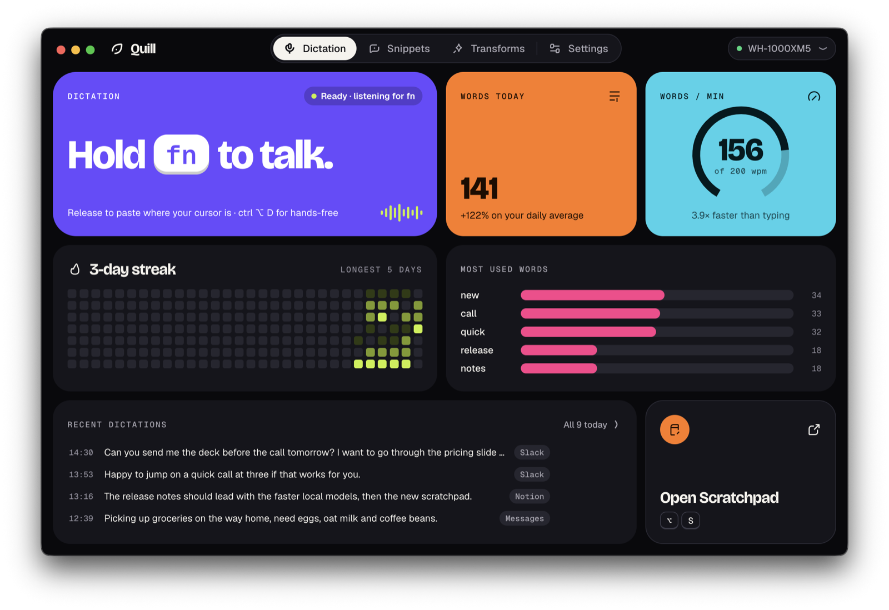
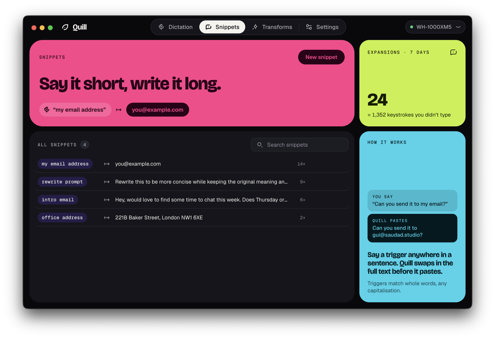
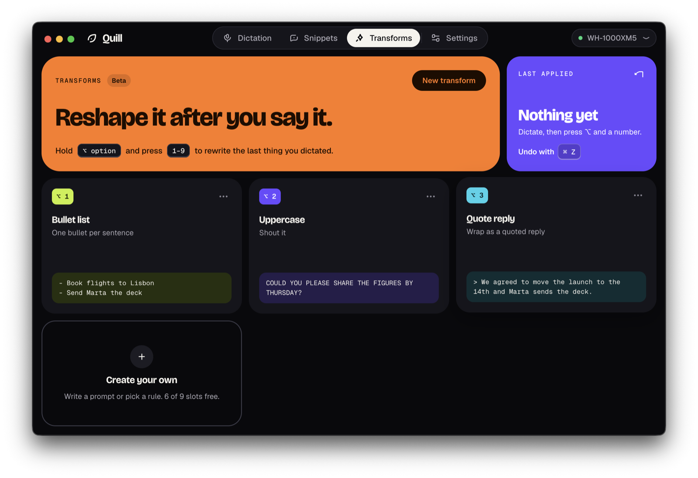
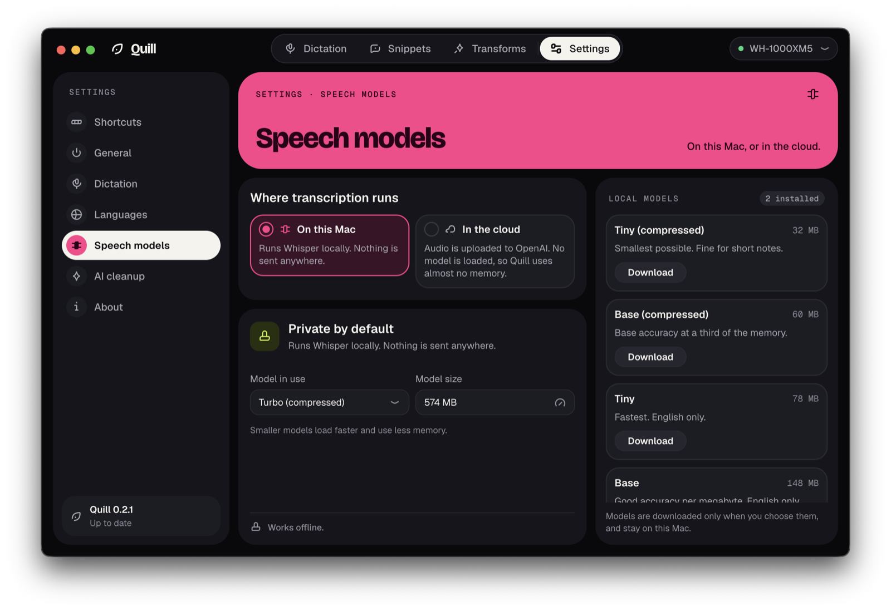
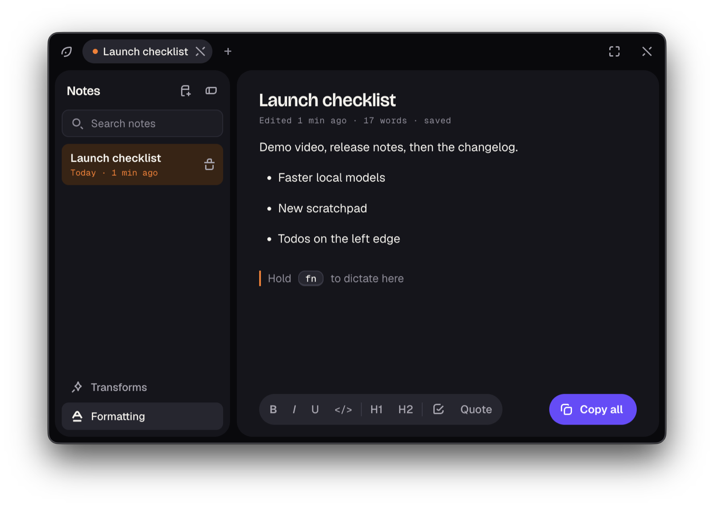

# Quill

Hold a key, speak, and your words are typed into whatever app you are using.
Quill transcribes on your own machine with [whisper.cpp](https://github.com/ggerganov/whisper.cpp),
so it works offline and your audio stays on your computer.



## Download

Get the latest build from [Releases](https://github.com/qruz-hq/quill/releases).
macOS 14+ on Apple silicon. Windows and Linux are in preview, see [docs/PLATFORMS.md](docs/PLATFORMS.md).

On first launch Quill asks for the microphone and Accessibility (needed for the hotkey and for typing into other apps).

## What you get

| | |
|---|---|
|  |  |
| **Snippets.** Say a short trigger, get the full text. | **Transforms.** Press `⌥1` to `⌥9` to reshape what you just said. |
|  |  |
| **Your choice of model.** From Tiny to Turbo, downloaded only when you pick one. Cloud transcription is optional. | **Scratchpad.** `⌥S` opens a notepad you can dictate straight into. |

Also: several languages at once, a streak and words-per-minute view, and optional AI cleanup with your own OpenAI key.

## Development

```bash
bun install
bun run helper:build  # native helper (Rust)
bun run stt:build     # Swift helper, macOS only
bun run dev
```

`bun run package` builds the app into `dist/`. Signing and releases are in [docs/RELEASING.md](docs/RELEASING.md).

## Contributing

See [CONTRIBUTING.md](CONTRIBUTING.md). Report security problems through [SECURITY.md](SECURITY.md), not public issues.

## License

[MIT](LICENSE)
